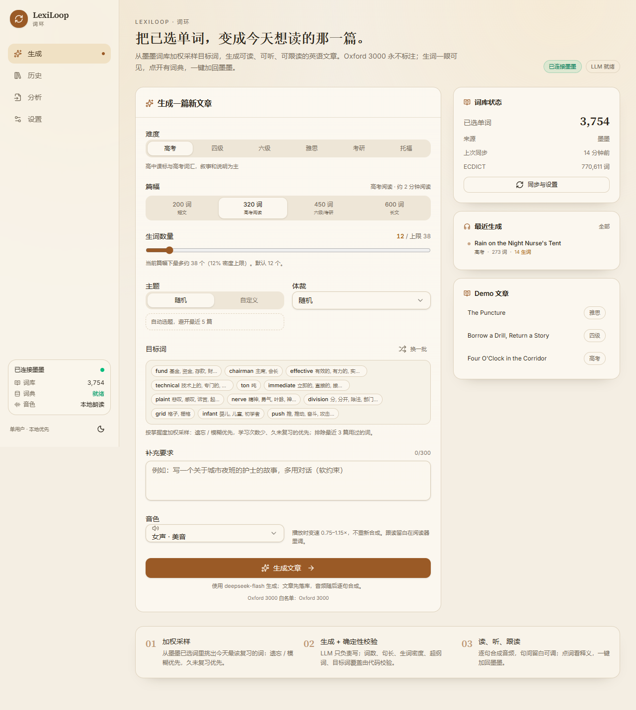
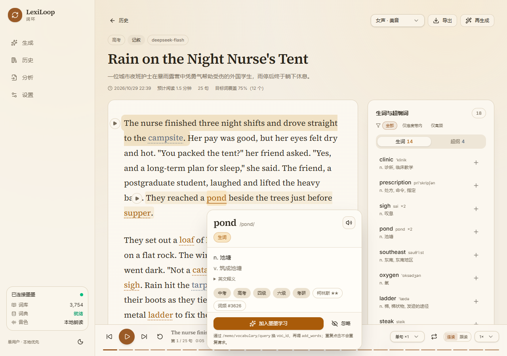
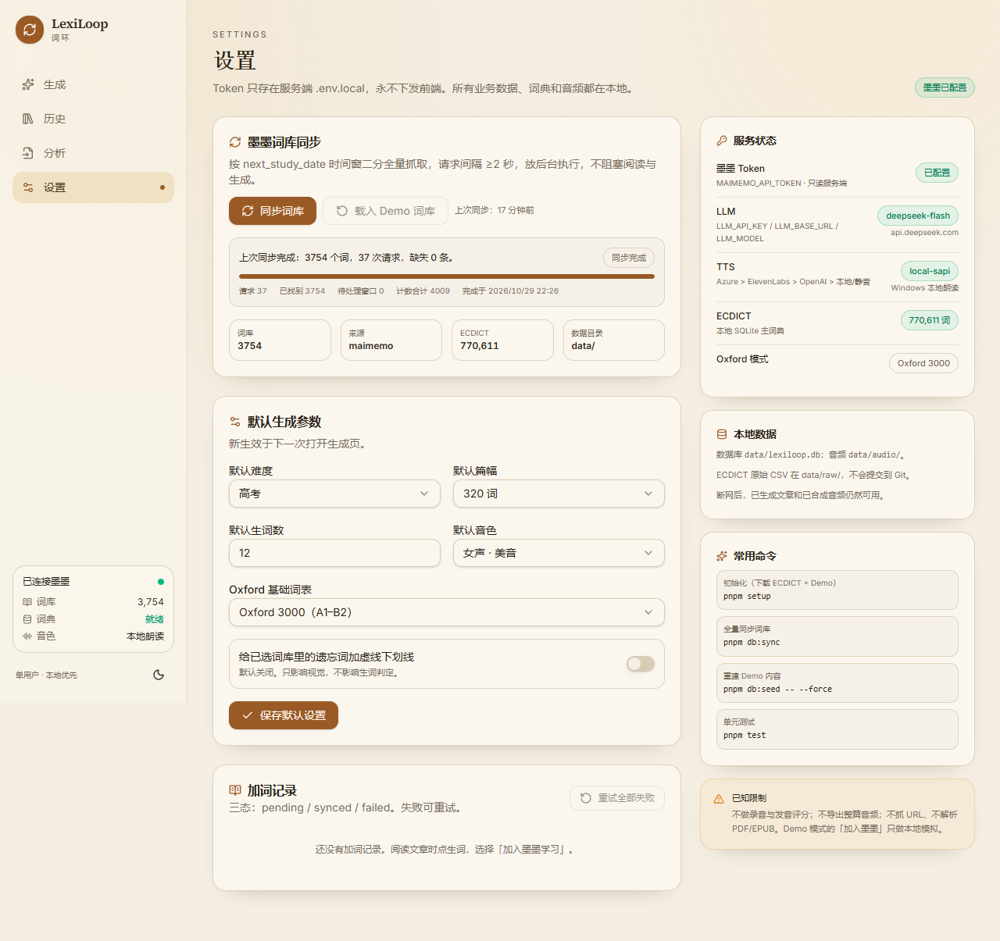

# LexiLoop（词环）

> 把我在墨墨背单词里「已选入」的单词，变成可读、可听、可跟读的英语文章；文章里的生词一眼可见、点开有详情、一键加回墨墨。

单用户、本地优先的 Next.js 应用。业务数据在 SQLite，音频在本地磁盘，Token 只读服务端。没有 Token 也能用完整的 Demo 模式体验。



> 需求原文：[docs/01-优化后的提示词.md](docs/01-优化后的提示词.md)

---

## 目录

- [功能](#功能)
- [快速开始](#快速开始)
- [环境变量](#环境变量)
- [使用流程](#使用流程)
- [标注规则（核心）](#标注规则核心)
- [架构](#架构)
- [数据模型](#数据模型)
- [生成流水线](#生成流水线)
- [TTS 与影子跟读](#tts-与影子跟读)
- [墨墨同步与加词](#墨墨同步与加词)
- [Demo 模式](#demo-模式)
- [测试与验收](#测试与验收)
- [假设](#假设)
- [已知限制](#已知限制)
- [Docker](#docker)
- [命令速查](#命令速查)
- [故障排查](#故障排查)

---

## 功能

- **从词库生成文章**：按掌握度加权采样目标词，交给 LLM 写 200/320/450/600 词文章；代码做确定性校验，不合格自动回传违规词重写，最多 2 轮。
- **分析已有文章**：粘贴或上传 `.txt` / `.md`，原生 `Intl.Segmenter` 分句分词，ECDICT lemma 还原，Oxford 3000 白名单，生词/超纲词标注，侧栏筛选与一键加词。
- **阅读器**：Source Serif 4 长文排版、米色/深色主题、桌面 Popover 词卡、移动端底部 Drawer、句级播放键、当前句高亮与自动滚动。
- **词典卡**：ECDICT 释义/音标/词形/考试标签/柯林斯/词频；ECDICT 无例句时可用 LLM 生成并标注「AI 生成」；墨墨个人内容按需读取。
- **逐句 TTS**：Azure / ElevenLabs / OpenAI，Windows 本地 SAPI 作为离线后备；音频按 `hash(text+voice+provider+model)` 缓存。
- **影子跟读**：连读版（句间 300ms）与跟读版（留白 = 句长 × 0.8/1.2/1.6），单句循环 1/3/5 次，整篇循环，0.75–1.15× 变速且保持音高。
- **加词闭环**：拼写换 `voc_id` → `add_words` → 三态记录（pending/synced/failed）→ 重分析文章，该词变「已知」。
- **Demo 模式**：无 Token 时 300 个示例词、3 篇预置文章、75 句真实本地朗读音频（Windows SAPI 预生成）；加词只做本地模拟并有明确提示。
- **深色模式 / 375px 移动端 / 键盘与 aria**：空格播放、←/→ 切句、R 重播。

| 阅读器 | 词卡 |
|---|---|
|  |  |

| 设置 | 移动端 |
|---|---|
|  |  |

---

## 快速开始

### 环境

- Node.js **22 LTS 或 24**（本机用 24.18.0 验证）
- pnpm 11
- Windows / macOS / Linux 均可；Windows 额外支持本地 SAPI 朗读

### 安装

```bash
pnpm install
pnpm setup
pnpm dev
```

打开 <http://127.0.0.1:3000>。

`pnpm setup` 会：

1. 下载 ECDICT（约 22 MiB 压缩包 / 770,611 词条）并解压到 `data/raw/`；
2. 导入 SQLite（`ecdict` + `lemma_map`，约 50,000 条例外词形）；
3. 生成 300 个 Demo 词与 3 篇 Demo 文章；
4. 用本机 Windows SAPI 预生成 Demo 音频（没有 SAPI 的平台会使用静音占位音轨）。

> 已有 `data/lexiloop.db` 且 ECDICT 已导入时，`pnpm setup` 会跳过重复导入。

> **`.env.local` 才是运行配置**：`.env.example` 只是模板，Next.js 与 CLI 都不会读取它。复制成 `.env.local` 后再填写 Token / Key；不要把密钥写回 `.env.example`。`scripts/*` 通过 `scripts/load-env.ts` 显式加载 `.env.local`。

### 生产模式

```bash
pnpm build
pnpm start
```

### 单元测试 / E2E

```bash
pnpm test          # Vitest：40 个用例
pnpm typecheck     # tsc --noEmit
pnpm e2e           # Playwright；Windows 默认复用本机 Edge
```

其他平台先安装浏览器：

```bash
pnpm exec playwright install chromium
pnpm e2e
```

---

## 环境变量

复制 `.env.example` 为 `.env.local`，按需填写。**Token 只读服务端，永不下发前端。**

> 常见错误：把 Token 填进 `.env.example`。它不会生效，而且容易被 Git 看到。正确做法是只改 `.env.local`（已在 `.gitignore` 中）。`DEMO_MODE` 必须留空，否则即使有 Token 也会强制 Demo 模式。

| 变量 | 必填 | 说明 |
|---|---|---|
| `MAIMEMO_API_TOKEN` | 否 | 墨墨开放 API Token；不填进入 Demo 模式 |
| `DEMO_MODE` | 否 | `1` 强制 Demo 模式 |
| `LLM_API_KEY` | 否 | OpenAI 兼容接口 Key；不填时生成页返回预置 Demo 文章 |
| `LLM_BASE_URL` | 否 | 默认 `https://api.deepseek.com/v1` |
| `LLM_MODEL` | 否 | 默认 `deepseek-chat` |
| `TTS_PROVIDER` | 否 | `azure` / `elevenlabs` / `openai` / `local` / `mock` |
| `AZURE_SPEECH_KEY` / `AZURE_SPEECH_REGION` | 否 | Azure Speech |
| `ELEVENLABS_API_KEY` / `ELEVENLABS_MODEL` / `ELEVENLABS_VOICE_ID` | 否 | ElevenLabs |
| `OPENAI_TTS_API_KEY` / `OPENAI_TTS_MODEL` | 否 | OpenAI TTS（不要复用 DeepSeek Key） |
| `DEFAULT_VOICE` | 否 | `female-us` / `male-us` / `female-uk` / `male-uk` |

Token 获取：墨墨 App → 我的 → 更多设置 → 实验功能 → 开放 API。本项目的所有墨墨请求都由 Route Handler 代为发出，前端只看到「已配置/未配置」。

### LLM 兼容性

`generateObject` 使用 JSON mode（`structuredOutputs: false`），可对接 DeepSeek、OpenAI 及大多数 OpenAI 兼容网关；若供应商只返回纯文本 JSON，会自动退回 `generateText` + JSON 提取 + Zod 校验。所有结构化结果都先过 Zod 再入库。

---

## 使用流程

1. **生成**：选择难度、篇幅、生词数量、主题、体裁、补充要求；目标词按掌握度加权采样，可「换一批」。生成后进入阅读器，音频后台逐句合成。
2. **阅读**：点有琥珀色点状下划线的生词 → 桌面 Popover / 移动端 Drawer；查看释义、音标、标签、词形、原句；可发音、加入墨墨或忽略。
3. **分析**：在「分析」页粘贴文章；侧栏按难度带 / 词频筛选，一键添加前 10 个。
4. **同步**：设置页点「同步词库」，SSE 实时进度；超过 24 小时会在生成时后台刷新。
5. **历史**：本地保存所有生成与导入文章；可删除、导出 `.txt`。

---

## 标注规则（核心）

优先级从高到低，命中即停：

| 优先级 | 条件 | 处理 | 颜色 |
|---|---|---|---|
| 1 | 非单词（标点、数字、URL、邮箱、代码、emoji） | 跳过 | 无 |
| 2 | 句中首字母大写且非句首（疑似专名） | 跳过 | 无 |
| 3 | 命中 **Oxford 3000 / 基础词表** | 跳过，即使不在已选词库 | 无 |
| 4 | lemma 在已选词库 | 跳过；`FORGET/VAGUE` 可选虚线 | 无 |
| 5 | 不在词库、不在基础表、在难度带内 | **生词**，可点击、可添加 | 琥珀色 + 点状下划线 |
| 6 | 不在词库、不在基础表、超出难度带 | **超纲词**，可点击 | 灰蓝色 + 点状下划线 |
| 7 | 同一 lemma 第 2 次及以后 | 同色，透明度 60% | 同上 |

**最重要的一条**：只要词在 Oxford 3000 里，即使不在已选词库，也不算生词、不标注。`abandon`、`absorb` 属于 Oxford 3000，永不标注。

> 本地 `oxford-3000.txt` 收录 2,967 个**单词**（Oxford 3000 原表里的多词短语被排除，同形词去重）；此外用 ECDICT 的 `oxford` 标记做交叉校验，命中任一即视为基础词。

### 词形还原

只做**屈折**还原，不做派生还原：

- `running → run`、`went → go`、`better → good`、`nurses' → nurse`、`don't → do`：会还原。
- `happiness → happy`、`unhappiness → happy`：**不会**。

实现顺序：缩写 → 所有格 → 手写不规则表 → ECDICT `exchange` 的 `p/d/i/3/r/t/s` 映射 → 保守规则回退。规则回退只在候选确实存在时使用，并对比较级/最高级要求明确 adj/adv 标注；本身是 Oxford/基础独立词的（teacher、corner、always、thing）不套规则，避免 `teacher → teach`、`thing → the` 之类的误伤。

### 难度带

ECDICT 标签累积映射：

- 高考：`zk gk`
- 四级：`zk gk cet4`
- 六级：`zk gk cet4 cet6`
- 雅思：`zk gk cet4 cet6 ielts`
- 考研：`zk gk cet4 cet6 ky`
- 托福：`zk gk cet4 cet6 toefl`

无标签词视为超纲。专有名词不计入超纲数。

---

## 架构

### 技术栈

| 层 | 选择 |
|---|---|
| 框架 | Next.js 15 App Router + React 19 + TS strict |
| UI | Tailwind v4 + shadcn 风格组件（Radix + cva）+ Lucide |
| 字体 | Source Serif 4（正文）+ Inter（UI），Fontsource 本地打包 |
| 状态 | TanStack Query（服务端状态）+ Zustand（忽略词持久化） |
| 数据库 | SQLite + Drizzle ORM + better-sqlite3 |
| LLM | Vercel AI SDK `generateObject` + Zod；失败退回 `generateText` |
| 词典 | ECDICT 导入 SQLite（主词典） |
| 分词 | `Intl.Segmenter` |
| 音频 | HTMLAudioElement 序列器；逐句文件 + 句间留白 |
| 测试 | Vitest + Playwright + MSW |

### 目录

```text
src/
  app/
    page.tsx                     生成页
    article/[id]/page.tsx        阅读器
    import/page.tsx              分析页
    library/page.tsx             历史
    settings/page.tsx            设置
    api/                         Route Handlers（含 SSE）
  components/
    ui/                          shadcn 风格基础组件
    reader/                      文章正文、词卡、侧栏、播放器
    generate/                    生成表单
  lib/
    analysis/                    分类上下文
    articles/                    文章持久化、DTO、摘要
    db/                          Drizzle schema、迁移、查询
    demo/                        Demo 文章/词库/种子
    dict/                        ECDICT、基础词表、lemma
    generation/                  采样、Prompt、校验、生成服务
    llm/                         AI SDK 封装
    maimemo/                     墨墨客户端、频控、同步
    text/                        清洗、分句、分词、分类、分析
    tts/                         Provider、缓存、任务、WAV
    words/                       词卡、AI 例句、加词
  hooks/ stores/
data/
  basic/                         Oxford 3000、功能词、专名、不规则表
  demo/                          Demo 词库快照
  raw/                           ECDICT 原始 CSV（gitignore）
  audio/                         TTS 音频（gitignore）
scripts/                         bootstrap / import / sync / seed
tests/ e2e/                      Vitest / Playwright
drizzle/                         SQL schema
```

### 关键接口

| 方法 | 路径 | 说明 |
|---|---|---|
| GET | `/api/status` | 全局状态（不含 Token） |
| GET/POST | `/api/vocab/targets`、`/api/vocab/sync` | 目标词预览、同步 |
| GET | `/api/vocab/sync/stream` | 同步进度 SSE |
| POST | `/api/articles/generate` | 生成文章 |
| GET/DELETE | `/api/articles/[id]` | 文章 DTO / 删除 |
| POST/GET | `/api/articles/[id]/tts` | 启动/查询逐句 TTS |
| GET | `/api/articles/[id]/tts/stream` | TTS 进度 SSE |
| GET | `/api/audio/[hash]` | 音频，支持 Range |
| POST | `/api/analyze` | 导入分析 |
| GET | `/api/words/[lemma]` | 词卡数据 |
| GET | `/api/words/[lemma]/examples` | AI 例句（缓存） |
| GET | `/api/words/[lemma]/personal` | 墨墨个人内容（按需） |
| POST | `/api/words/add` | 加词（幂等） |
| GET/POST | `/api/additions`、`/api/additions/retry` | 三态记录与重试 |
| GET | `/api/tts/pronounce` | 单词发音 |
| GET/PATCH | `/api/settings` | 默认参数 |

### 数据模型

在需求最小集上增加：

- `articles.kind`：`generated | imported | demo`
- `article_tokens`：额外的 `sentence_index/start_offset/end_offset/known_response/repeat`
- `article_audio(article_id, idx, voice)`：句级音频状态，支持切换音色/重试
- `ecdict.pos/bnc/detail`：词性、BNC 词频、详情
- `additions.simulated`：区分 Demo 模拟与真实写入
- `vocab.source`：`maimemo | demo`

`settings` 保存默认参数、上次同步时间、同步摘要；同步断点保存在 `data/tmp/vocab-sync.json`。

---

## 生成流水线

1. **准备词库**：读 SQLite；为空时 Demo 模式自动载入 300 词，否则提示先同步。
2. **采样目标词**：权重 = 响应状态（FORGET/VAGUE ×8、STICKING ×4、WELL_FAMILIAR ×0.6）× 学习次数（越少越高）× 距上次学习天数（越久越高）。排除最近 3 篇用过的词；目标数量受 `篇幅 × 12%` 上限约束。
3. **生成**：把难度、篇幅、主题、体裁、目标词（含中文提示）、新词预算、补充要求交给 LLM。**不把 3,754 个词塞进 Prompt**。另外给出一小组「候选新词」（难度带内、不在用户词库、不在 Oxford 3000，带中文提示），让模型有可控的新词调色板，而不是全篇只用基础词。输出 JSON Schema 固定。
4. **确定性校验**（代码，不让 LLM 自检）：
   - 词数 `320 ±15%`
   - 句子 14–24，单句 ≤30 词，平均 ≤22 词
   - 生词数 ≥ 目标 − 3 且 ≤ 目标 + 3，密度 ≤12%
   - 超纲词 ≤4（专有名词不计）
   - 目标词覆盖 ≥60%
   - 无中文、无 Markdown、无括号、标题 ≤8 词且非模板
5. **修复**：只有阻塞项才重写，最多 2 轮；把违规词清单、缺失目标词回传。若仍不达标，接受并显示「含 N 个超纲词」/警告，可「再生成」。
6. **落库 + 异步 TTS**：文章先可读；逐句音频后台生成，SSE 推进度。

### 校验器的分级

- **阻塞**（触发重写）：生词数上下界/密度、超纲数、目标词覆盖、中文/Markdown/括号、标题。
- **警告**（只提示，不重写）：词数、句数、单句长度、平均句长。

这比需求原文的「只有 3 种情况重写」稍严格：格式污染、标题违规、**生词数过少**也会被拦下，因为它们是硬约束/验收标准。已在代码注释和本文档中标注。

---

## TTS 与影子跟读

- 逐句合成，不做整篇强制对齐；每句一个音频文件，客户端按句序列播放。
- 缓存键：`sha256(provider|model|voice|text)`，文件落在 `data/audio/<hash>.<ext>`。
- Provider 优先级：显式 `TTS_PROVIDER` → Azure → ElevenLabs → OpenAI TTS → Windows SAPI → 静音占位。
- Windows SAPI 是**离线后备**（不在需求 §7.4 的三家里，属扩展）：脚本在 `data/tmp/tts-sapi.ps1` 自动生成，`stdio: 'ignore'`，不依赖命名管道；仅使用系统已安装英文音色，通常是 Ziva（女声美音）。其他平台自动跳过。
- 云端 MP3 的时长按词数估算；WAV（本地/静音）从文件头读取精确时长。跟读留白因此对云端是近似值。
- 播放器：`audio.preservesPitch = true`，变速不重新合成；句间留白可调；单句循环 1/3/5 次；整篇循环；按句进度条可点击跳转。
- **不做录音、不做发音评分、不导出整篇音频**（导出需要 ffmpeg，v1 明确不做）。

---

## 墨墨同步与加词

### 频控

- 请求间隔 ≥2 秒，全局串行。
- 10 秒 20 次、60 秒 40 次、5 小时 2000 次。
- 429：优先 `Retry-After`，否则 20s 起指数退避，最多 5 次。

### 时间窗全量同步

接口没有 offset 分页，只能按 `next_study_date` 时间窗二分：

```ts
const queue = [[MIN, MAX]]
while (queue.length) {
  const [s, e] = queue.shift()
  const count = await countWindow(s, e)     // as_count: true
  if (count === 0) continue
  if (count > 1000) {
    const mid = new Date((+s + +e) / 2)
    const leftEnd = new Date(mid.getTime() - 1) // 接口 start/end 闭区间，左窗减 1ms
    queue.push([s, leftEnd], [mid, e])
    continue
  }
  const records = await fetchWindow(s, e)   // limit: 1000
  records.forEach(r => all.set(r.voc_id, r))
}
```

- 根窗口 `[2000, 2100]` 的 `as_count` 作为权威总数 `planTotal`；**不要用无日期过滤的 as_count**：本账号无日期返回 3,761，而日期窗口是 3,754，多出的 7 条 `next_study_date` 为空。
- 每处理一个窗口就把 `queue / processed / records / planTotal` 写入 `data/tmp/vocab-sync.json`，中断后继续。
- 完成后写 `vocab` 表、清掉 Demo 词、记录 `vocabLastSync` 与 `vocabSyncSummary`（`missing = planTotal - 去重 voc_id 数`）。
- 24 小时 TTL；过期时生成文章会在后台刷新，不阻塞。

**真实账号实测结果（2026-10-29）**：3,754 个词、37 次请求、`missing = 0`、约 75 秒；叶子窗口计数合计 4,009，其中 255 是时间窗边界的重复计数，不参与 `missing`。这同时验证了 `/memo/study/query_study_records` 的路径与返回结构。

### 加词

1. 检查本地 `vocab` 与 `additions`，已在计划/已成功则直接返回，不重复请求。
2. `POST /memo/vocabulary/query` 用拼写换 `voc_id`（≤1000）。
3. `POST /memo/study/add_words`，body `{ words: [{id}], advance: false }`。
4. 返回 `added_count`：
   - `1`：写入本地 `vocab`，记录 `additions.synced`，重分析文章 → 该词变「已知」。
   - `0`：如实提示「可能已在计划或达到上限」，**不**在本地假装已知。
5. 第一次写接口调用会打印脱敏后的请求/响应：ID 只显示前 6 后 2 位，不含 Token。

### 路径兼容

需求 §10 使用 `/memo/study/...`；官方现行文档使用 `/study/...`。客户端以需求路径为主，404 时自动回退到无 `/memo` 前缀的官方路径，并记住成功路径。两种成功响应都兼容 `{success,data}` 包裹与直接对象，`voc` / `records` 两种词表键都能解析。

---

## Demo 模式

触发条件：未配置 `MAIMEMO_API_TOKEN`，或 `DEMO_MODE=1`。

- 300 个示例词：从 ECDICT 高频、非 Oxford、非功能词/专名中抽取，带 FORGET/VAGUE/STICKING 分布。
- 3 篇预置文章：夜班护士（记叙/高考）、工具图书馆（新闻/四级）、补胎对话（对话/雅思）。
- 75 句真实音频：用 Windows SAPI 预生成（`local-sapi`），无 SAPI 时静音占位。
- 生成：没有 `LLM_API_KEY` 时返回预置 Demo 文章并明确提示「参数未生效」。
- 加词：写入本地 Demo 词库，`added_count` 返回 1，`additions.simulated=1`；卡片和设置页都标注「Demo 模拟」。
- 设置页可「载入 Demo 词库」重置示例数据。

---

## 测试与验收

### 已运行结果

| 命令 | 结果 |
|---|---|
| `pnpm typecheck` | ✅ 通过 |
| `pnpm test` | ✅ 6 个文件 / 40 个用例通过 |
| `pnpm build` | ✅ 通过（Next 15.5.28，首屏共享 JS 103 kB） |
| `pnpm e2e` | ✅ 2 个用例通过（本机 Edge 156） |
| 真实墨墨同步 | ✅ 3,754 词 / 37 次请求 / `missing=0` / 断点续传 |
| 真实 DeepSeek 生成 | ✅ 273 词、25 句、14 个生词、密度 6.2%、超纲 4、目标覆盖 75%、可接受（句数 25 为非阻塞警告） |
| 真实 `add_words` | ✅ 用已在计划中的词验证，返回 `added_count=0`（未新增词） |
| API 冒烟 | ✅ 页面 200；函数词/Oxford 文本 0 标注；Demo 加词后 token → known；Range 音频 206 |
| Demo 音频 | ✅ 75 句 / 0 失败 / 总时长约 354 秒 |

单元测试覆盖：分词与 offset、连字符/所有格/缩写、lemma（屈折 vs 派生）、分类器（Oxford 优先、专名、难度带、重复）、校验器分级、时间窗切分与断点续传、墨墨客户端（路径回退、429、add_words、词表解析）。E2E 覆盖：打开 Demo 文章 → 点生词 → 词卡 → 模拟加词 → 词变已知；分析页 → 分析 → 进入阅读器。

### 对照需求 §12

| # | 验收标准 | 状态 |
|---|---|---|
| 1 | 只含 `a/an/the/it/is/of/to` 的文字，标注数 0 | ✅ 单测 + API |
| 2 | Oxford 3000 词（`abandon`）即使不在词库也不标注 | ✅ 单测 + API |
| 3 | 全量同步约 3754 条，`missing=0`，可续传 | ✅ 真实账号：3,754 词 / 37 请求 / `missing=0`；unit 测试另覆盖断点续传 |
| 4 | 320 词高考文章：生词 12±3、密度 ≤12%、超纲 ≤4、覆盖 ≥60% | ✅ 真实 DeepSeek：273 词 / 14 生词 / 6.2% / 超纲 4 / 覆盖 75%；句数 25 为非阻塞警告 |
| 5 | 点生词 300ms 内出卡 | ✅ API 热态约 125ms；E2E 通过；冷启动 dev 首次编译会更慢 |
| 6 | 加词返回 `added_count=1`，重分析变已知 | ✅ Demo 模拟路径端到端；✅ 真实 `add_words` 用已存在词验证返回 0；⚠️ 真实“新增 1 个词”未做（避免改动用户学习计划） |
| 7 | 跟读留白可调、单句循环 3 次、变速不改音高 | ✅ 控件与 `preservesPitch` 已实现；未做音频音高测量 |
| 8 | 刷新后文章/标注/音频仍在，断网可读可听 | ✅ 本地 SQLite + 文件；无外部 CDN 依赖 |
| 9 | 连续 5 篇主题不重复、标题不模板化 | ⚠️ 已真实生成 1 篇；最近 5 篇主题排除与标题校验已实现，连续 5 篇未跑 |
| 10 | 墨墨挂掉有提示，Demo 可完整体验 | ✅ 错误包裹 + Demo；未制造真实宕机 |

**仍未覆盖的部分已明确标注**：真实“新增 1 个词”、连续 5 篇生成、真实 429 未执行；不会把算法测试或 Demo 模拟当成线上验证。真实同步、真实生成、真实 `add_words=0` 已完成。

---

## 假设

需求 §1.4 要求把不确定的产品语义写在这里：

1. **Oxford 3000 即 A1–B2**。因此设置里的「Oxford 3000」与「仅 A1–B2」当前等价；保留两项是为未来 Oxford 5000 C1 扩展。`关闭` 时只保留功能词白名单。
2. **`data/` 的 gitignore 范围变窄**：只忽略 `data/raw/`、`data/lexiloop.db*`、`data/audio/`、`data/tmp/`；`data/basic/` 与 `data/demo/` 必须入库，否则新克隆无法判定 Oxford。
3. **ECDICT 的 `pos` 字段大量为空**，因此不能用 POS 作为唯一门闩。实现上组合：ECDICT exchange 映射 → 手写不规则表 → 规则回退 + 「本身是基础词条则不再拆」+ 比较级要求明确 adj/adv。
4. **`frq` / `bnc` 数值越小越常用**，只用于侧栏排序和词卡元信息，不参与生词判定。
5. **墨墨请求格式**：日期按官方文档使用 ISO 8601 北京时间（`+08:00`）；路径优先需求 §10 的 `/memo/...`，404 回退 `/study/...`；响应同时兼容 `{success,data}` 与直接对象；`tags` 兼容字符串与数组。
6. **`added_count=0` 语义模糊**（已在计划或上限）。本项目不把它当作成功写入，也不在本地伪造成「已知」，UI 如实提示。
7. **TTS 默认 Azure**；无云 Key 时 Windows 上使用 SAPI 本地朗读，其他平台使用静音占位音轨。这是为「Demo 可完整体验」增加的扩展 Provider，不替代需求里的三家。
8. **Demo 加词是模拟**。配置 Token 后才会真正请求墨墨；界面和 `additions.simulated` 都会标明。
9. **没有 LLM 时生成页返回预置文章**，并明确提示难度/篇幅/目标词未生效；不静默伪装成真实生成。
10. **文章正文无中文，但 `summary_zh` 是中文**。硬约束里的「无中文」只约束标题与句子，不约束这个历史列表摘要字段。
11. **补充要求软约束**：超过 300 字截断；与硬约束冲突时以硬约束为准，命中风险词时返回「部分要求未采纳」警告。
12. **单用户本地工具**：无账号、无鉴权；开发与生产脚本默认绑定 `127.0.0.1`。Docker 中显式 `HOSTNAME=0.0.0.0` 并只映射到宿主机回环地址。
13. **云端 MP3 时长是估算**，因为不引入 ffmpeg；本地 WAV 是精确的。
14. **数据模型有扩展**：`article_audio`、`articles.kind`、`vocab.source`、`additions.simulated`、`ecdict.pos/bnc/detail`，原因见上。
15. **AI 例句缓存**写入 `word_lookup`，键为 `ai-examples:<lemma>`；墨墨个人内容只在内存缓存 10 分钟。
16. **Node 版本**：需求写 Node 22 LTS；本机实际使用 Node 24.18.0 验证，`engines` 要求 `>=22`。
17. **E2E 浏览器**：Windows 本机复用已安装 Edge（`channel: 'msedge'`），不额外下载 Chromium；其他平台需 `playwright install chromium`。
18. **候选新词调色板**：目标词都来自用户词库，因此天然是 `known`，不会被计为「生词」；为了达到「生词 12±3」，生成时额外从难度带内挑 24–48 个不在词库、不在 Oxford 的候选词（带中文提示）交给模型。这不是把全量词库塞进 Prompt。
19. **生词数下界是额外阻塞项**：需求 §3.2 的修复条件只写了「超过目标 + 3」，但 §12 验收要求 12±3，所以实现把「少于目标 − 3」也作为阻塞项触发重写。这是一处有意的偏离。
20. **`.env.local` 加载**：Next.js 自动加载；CLI 脚本通过 `scripts/load-env.ts` 显式加载。`.env.example` 永远只是模板，不读取。
21. **推理模型的 token 预算**：当前 DeepSeek `deepseek-flash` 会先消耗 reasoning tokens，`maxOutputTokens` 默认提高到 12,000；3000 时 320 词文章可能在 reasoning 阶段耗尽预算返回空 content。
22. **句子数 25**：生成样例实际 25 句，超出 14–24；按需求这份检查是非阻塞警告，因此仍接受。若希望严格卡 24 句，可把 `sentence_count` 改为 blocking。

---

## 已知限制

- **真实 `add_words` 只验证了 `added_count=0`**：用已在学习计划中的词调用，未向用户计划新增词；真实「新增 1 个词」需要你点一次「加入墨墨学习」。
- **真实生成只跑了 1 篇**：320 词样例耗时约 42.6 秒，超过需求中的 P95 25 秒；DeepSeek 推理模型的延迟波动较大。连续 5 篇主题去重未跑。
- **真实 429 未触发**：客户端按 20/10s、40/60s、2000/5h 限速并实现 `Retry-After` 退避，单测用 MSW 覆盖 429；没有故意打爆线上频控。
- **Docker 未实际构建**：Dockerfile / compose 已提供，但本机没有执行镜像构建；Windows 上 `output: standalone` 的符号链接问题默认关闭。
- **Windows SAPI 只有女声美音**（本机为 Microsoft Zira）：英音/男声需配置云 TTS；Linux Docker 内无 SAPI。
- **不做**录音、发音评分、整篇音频导出、URL 抓取、PDF/EPUB、Anki/Notion 同步。
- **生词密度**在导入文章中只提示，不修改原文；生成文章才会触发重写。
- **ECDICT 覆盖有限**：极新词、专业缩写可能标成超纲；专有名词靠大小写与白名单启发式，句首人名可能漏判。
- **词频排序**依赖 ECDICT 的 `frq/bnc`；缺失词排在最后。
- **Demo 回退不遵守参数**：它只是让阅读/词卡/音频可体验，不冒充 320 词定制生成。

---

## Docker

> Docker 内没有 Windows SAPI；请配置云 TTS，否则是静音占位音轨。容器复用宿主机的 `data/`，所以**先在宿主机完成 `pnpm setup`**。

```bash
pnpm install
pnpm setup
cp .env.example .env.local   # 填 Token / LLM / TTS（可留空）
docker compose up --build
```

访问 <http://127.0.0.1:3000>。`docker-compose.yml` 已把端口绑定到 `127.0.0.1`，避免局域网暴露。

构建时会设置 `NEXT_OUTPUT_STANDALONE=1`；Windows 本机直接 `pnpm build` 时不开 standalone，以规避 Windows 无开发者模式时的符号链接 EPERM。

---

## 命令速查

```bash
pnpm dev             # http://127.0.0.1:3000
pnpm build           # 生产构建
pnpm start           # 生产启动（127.0.0.1）
pnpm setup           # 下载 ECDICT + 导入 + Demo
pnpm db:import       # 只导入 ECDICT（可加 --force）
pnpm db:seed         # 写入 Demo；--force --reset-vocab --no-audio
pnpm db:sync         # CLI 全量同步墨墨
pnpm test            # Vitest
pnpm typecheck       # TS
pnpm e2e             # Playwright
pnpm db:generate     # drizzle-kit generate
```

---

## 故障排查

| 现象 | 处理 |
|---|---|
| 页面提示「还差一步：导入 ECDICT」 | 运行 `pnpm setup`；确认 `data/raw/ecdict.csv` 约 66 MB |
| 所有词都不标注 | 词库/ECDICT 是否为空；是否把 Oxford 模式设为「关闭」；检查设置页状态 |
| 生成返回 Demo 文章 | 没配 `LLM_API_KEY`，或 Key 无效；看终端 `[llm]` 日志 |
| 音频没声音 | 设置页 TTS 显示 `mock` 即静音占位；Windows 应显示 `local-sapi`；云 Key 是否填写并重启 |
| 墨墨 429 | 客户端已自动退避；等待后重试，不要并发点同步 |
| 同步中断 | 重新点同步，会从 `data/tmp/vocab-sync.json` 续传 |
| Token 无效 | 重新获取 Token 更新 `.env.local` 并重启；日志不会打印 Token |
| 端口占用 | `pnpm dev -- -p 3100`，或结束占用 3000 的进程 |
| `better-sqlite3` 安装失败 | 使用 Node 22/24 与 pnpm 11；确认 `pnpm-workspace.yaml` 的 `allowBuilds` 生效 |
| E2E 找不到浏览器 | `pnpm exec playwright install chromium`，或设置 `PLAYWRIGHT_CHANNEL=msedge` |

---

## 交付清单

- 可运行仓库（本目录）+ 本 README
- `.env.example`
- `docker-compose.yml` + `Dockerfile`
- `scripts/bootstrap.ts`、`scripts/import-ecdict.ts`、`scripts/sync-vocab.ts`、`scripts/seed-demo.ts`
- `data/basic/`（Oxford 3000、功能词、专名、不规则表）
- `data/demo/`（Demo 词库快照）
- `drizzle/0000_init.sql`
- Vitest 单测 + Playwright E2E + MSW
- 截图 `docs/screenshots/`
- 需求原文 `docs/01-优化后的提示词.md`

### 接口实测结论

需求 §10 是实现依据。**已在真实账号上验证只读同步与一次写接口**：

- 全量同步按 `next_study_date` 二分；真实结果 3,754 词 / 37 请求 / `missing=0`。根窗口日期计数 `planTotal=3754`；无日期 `as_count=3761`（多 7 条无 `next_study_date` 的记录），所以 `missing` 用 `planTotal - 去重 voc_id 数`，叶子计数只用于进度。
- `add_words` 用已在计划中的词调用，真实返回 `added_count=0`，并打印脱敏请求/响应（ID 只显示前 6 后 2 位）。
- `query_study_records` 支持 `/memo/...` 与 404 回退 `/study/...`；本项目两条路径都实测走通（先 404 后回退）。
- 个人释义/例句/助记只在用户展开时读取，接口为空则不显示；本次未对个人内容做真实写入。
- 墨墨不提供释义、音标、例句、发音音频、词书元数据；这些全部走 ECDICT / LLM / TTS。
